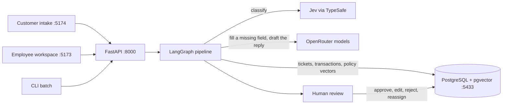
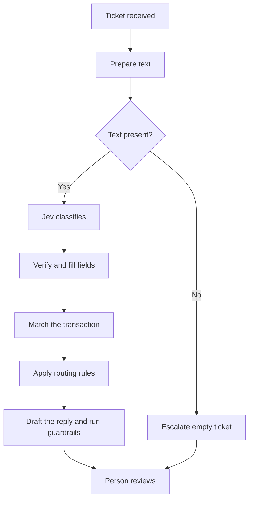

# ZainCash Support Pipeline

Back-office automation for Iraqi Arabic support tickets. The pipeline classifies each ticket, extracts its details, finds the relevant transaction, routes it to a team, and prepares a grounded reply for human review.

Built for the **Agentic AI Challenge Iraq, Topic 06: Support Pipeline Automation**.

> **People stay in control.** The pipeline never sends replies, moves money, or changes accounts. Uncertain or unsafe outcomes are escalated with a reason.

## Architecture

Two web apps and a CLI send tickets to one API. The API runs a LangGraph pipeline, then holds every result for a person to review.



Docker Compose runs the API and Postgres. The customer intake app and the employee workspace run separately with npm. Jev is the only classifier. Gemini is called only when a required field has no span. Claude writes the cited reply. Postgres stores tickets, the transaction lookup, and the policy embeddings.



An empty ticket skips classification, lookup, and drafting, and is escalated. Every other ticket follows `prepare → jev_classify → extract → lookup → decide → draft`. The graph stops there. A person approves, edits, rejects, or reassigns. Nothing is sent.

[Open the same diagrams as a standalone page](docs/pipeline-architecture.html).

## How a ticket flows

| Step | What happens | Model | Code |
|---|---|---|---|
| Arrive | A customer submits intake, or an employee uploads tickets. | `anthropic/claude-sonnet-5.5` (`INTAKE_MODEL`) | `backend/app/intake/` |
| Prepare | Normalize the text, mask card numbers, and find candidate spans. | None | `backend/app/pipeline/stage1_normalize/` |
| Classify | Choose the category, priority, flags, and text spans. Jev is the only classifier. | `jev-1.13.0` (`JEV_MODEL`), through TypeSafe | `backend/app/pipeline/stage2_classify/jev.py` |
| Extract | Normalize the spans Jev chose. Gemini is asked only when a required field has no span. A low-confidence Jev pick is kept. | `google/gemini-3.8-flash` (`GEMINI_MODEL` default), through OpenRouter, for a missing span only | `backend/app/pipeline/stage3_extract/extract.py` |
| Lookup | Match the transaction. | None. SQLAlchemy and Postgres. | `backend/app/pipeline/stage4_lookup/` |
| Decide | Assign the team and priority. If Jev is not confident, escalate and tell the reviewer: "the classifier was not confident." | None. Rules in [`data/taxonomy.yaml`](data/taxonomy.yaml). | `backend/app/pipeline/stage5_decide/rules.py` |
| Draft | Retrieve policy chunks, write a cited reply, and run the guardrails. Jev checks credential wording. | Reply: `anthropic/claude-sonnet-5.5` (`ANTHROPIC_MODEL`). Retrieval: `openai/text-embedding-3-small` (`EMBEDDING_MODEL` default), 768 dimensions. | `backend/app/pipeline/stage6_draft/` |
| Review | An agent approves, edits, rejects, or reassigns. Nothing is sent. | None | Employee workspace |

The graph is `prepare → jev_classify → extract → lookup → decide → draft`. An empty `ANTHROPIC_MODEL` or `INTAKE_MODEL` uses `GEMINI_MODEL` for that step. `GEMINI_STRONG_MODEL` and `GEMINI_EMBED_MODEL` are not called.

## Quick start

### 1. Configure the environment

You need WSL Ubuntu, Docker, `uv`, Node.js, a TypeSafe key, and an OpenRouter key.

```bash
cp .env.example .env
```

Set `TYPESAFE_API_KEY` and `OPENROUTER_API_KEY` in `.env`. The model for each step is in the table above; `.env.example` already contains those IDs.

Copy every file in `secrets/` from its `.example` counterpart, removing the `.example` suffix. Compose builds `DATABASE_URL` from those files; do not put that URL in `.env`.

### 2. Start Postgres and the API

From the repository root:

```bash
docker compose up --build
```

Wait until both containers are healthy. Use `docker compose up --build -d` to run them in the background.

### 3. Start the employee workspace

In a second terminal:

```bash
cd employee-frontend
npm ci
npm run dev
```

### 4. Start customer intake (optional)

In a third terminal:

```bash
cd users-frontend
npm ci
npm --workspace web run dev
```

Restart the API after changing model settings.

| Application | Address |
|---|---|
| Employee workspace | http://localhost:5173 |
| Customer intake | http://localhost:5174 |
| API | http://localhost:8000 |
| API documentation | http://localhost:8000/api/docs |
| PostgreSQL | `localhost:5433` |

## Try the demo

1. Open **Knowledge base** and upload [`data/test-kb/judge-demo.ar.md`](data/test-kb/judge-demo.ar.md). Wait for **Indexed**. Do not also upload the copies in `data/test-kb/ar/`.
2. Open **New batch**, upload [`data/demo/rag_tickets.jsonl`](data/demo/rag_tickets.jsonl), and start processing with Jev-only classification.
3. Inspect the transfer, general question, fraud escalation, and out-of-scope result. Edit a reply and choose **Save & approve**.

The demo data is synthetic. Files in `data/kb/` are fictional guidance, not real ZainCash policies or promises.

See the [full demo walkthrough](docs/demo-readiness.md).

## Checks

Backend, from `backend/`:

```bash
uv run pytest -q
uv run ruff check app tests
```

Employee frontend, from `employee-frontend/`:

```bash
npm test
npm run lint
npm run build
```

PostgreSQL integration tests use the separate `support_test` database.

Run a Jev-only CLI batch from the repository root:

```bash
uv --directory backend run support run-batch \
  ../data/demo/rag_tickets.jsonl --out ../out/run.json
```

## More documentation

- [Architecture and ticket flow](docs/pipeline-architecture.html)
- [Demo readiness and remaining work](docs/demo-readiness.md)
- [Full design specification](docs/superpowers/specs/2026-10-07-support-pipeline-design.md)
- [RAG verification record](docs/verification/2026-10-17-rag-drafting.md)
- [Customer-intake verification record](docs/verification/2026-10-18-customer-intake.md)

The review workspace and RAG drafting flow are implemented. Held-out evaluation, broader packaging/CI, and formal disclosure work remain.

## License

This project is proprietary. The [license](LICENSE) allows a recipient to read and study the source and ask the copyright holder questions. Publishing, selling, sharing it outside that recipient, and reusing it require Saif Almaliki's prior written approval.
