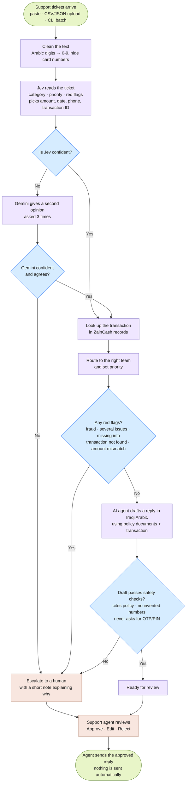

# ZainCash Support Pipeline

This is a back-office pipeline for ZainCash support tickets written in Iraqi dialect. For each ticket it decides the category, sets a priority, extracts the key details, finds the matching transaction, routes the ticket to the right team, and drafts a reply for a person to approve. It is not a chatbot, and it never sends anything on its own. If it is unsure about a ticket, it escalates it to a person with a note.

Built for the **Agentic AI Challenge Iraq, Topic 06: Support Pipeline Automation**.

## How a ticket flows



Colours in the diagram:
- **Green:** where tickets come in and where they finish.
- **Blue:** decisions the pipeline makes.
- **Purple:** automatic steps.
- **Orange:** steps a person handles.

Every path ends with a person approving the reply.

## Where each step lives

The diagram above is the path a ticket takes. This is the same path as code: the LangGraph node, the file under `backend/app/pipeline/`, and the tool or model that does the work.

| Flow step | LangGraph node | File(s) | Tool(s) / model |
|---|---|---|---|
| Clean the text (digits → 0-9, hide cards) | `prepare` | `stage1_normalize/normalize.py` | `normalize()`, `mask_cards()`, `fold_arabic()` |
| Find refs, phones, amounts, and dates | `prepare` | `stage1_normalize/candidates.py` | `find_candidates()` — recall-tuned regex, the options Jev is allowed to pick |
| Resolve relative dates | (used in extract) | `stage1_normalize/dates.py` | `resolve_date()` |
| Jev reads the ticket | `jev_classify` | `stage2_classify/jev.py` | Jev via langchain-typesafe: category, priority, flags, candidate picks (+ reversed-option check) |
| Gemini second opinion | `gemini_classify` | `stage2_classify/gemini.py` | Gemini structured output, 3 samples |
| Jev → Gemini → human decision | `gemini_classify` (cascade mode) | `stage2_classify/cascade.py` | `combine()` |
| Classify and extract prompts | — | `stage2_classify/prompts/gemini_classify_v1.md`, `gemini_extract_v1.md` | prompt files (versioned) |
| Extract ref, amount, date, phone | `extract` | `stage3_extract/extract.py` | `finalize()`, `fill_gaps()`, span verification. Gemini fills a field only when regex found nothing or the Jev pick is weak |
| Look up the transaction | `lookup` | `stage4_lookup/lookup.py` (+ `app/db/repository.py`) | `match_transaction()`, `lookup_transaction` tool |
| Route to team + red-flag check | `decide` | `stage5_decide/rules.py` | `decide()`, `merge_reasons()` |
| Draft the reply | `draft` | `stage6_draft/agent.py`, `stage6_draft/drafting.py` | LangChain `create_agent` |
| Safety checks on the draft | `draft` | `stage6_draft/guardrails.py` | Jev `requests_credentials` noul + regex |
| Knowledge-base search | `draft` (tool) | `stage6_draft/tools/search_knowledge_base.py` | `search_knowledge_base` |

The eight drafting tools live in `stage6_draft/tools/`:

| Tool | File | What it does |
|---|---|---|
| `lookup_transaction` | `tools/lookup_transaction.py` | exact ref lookup |
| `search_transactions` | `tools/search_transactions.py` | fuzzy search when no ref |
| `get_customer_recent_transactions` | `tools/customer_transactions.py` | recent activity |
| `get_customer_ticket_history` | `tools/ticket_history.py` | repeat contacts |
| `check_service_status` | `tools/service_status.py` | known outages |
| `search_knowledge_base` | `tools/search_knowledge_base.py` | pgvector policy chunks |
| `flag_for_human` | `tools/flag_for_human.py` | record an escalation reason |
| `submit_draft` | `tools/submit_draft.py` | record the draft (terminal) |

Orchestration, outside any single stage:

| What | File |
|---|---|
| Build the graph, run a batch, summarize | `pipeline/graph.py` |
| LangGraph state | `pipeline/state.py` |
| Shared dataclasses | `pipeline/contracts.py` |
| Wire real clients (Jev and Gemini) | `pipeline/factory.py` |
| Outcome → dict or database row | `pipeline/io/serialize.py` |

## Models

| Model | What it does here |
|---|---|
| **Jev** (TypeSafe System One) | Fast, cheap classification. Its confidence scores are calibrated, and it picks extracted values directly from the ticket text, so it cannot invent them. |
| **Gemini 3.8 Flash** (via OpenRouter) | Second opinion on uncertain tickets and fallback extraction. RAG drafting is planned for a later phase. |

## Design

The full design is in [`docs/superpowers/specs/2026-10-07-support-pipeline-design.md`](docs/superpowers/specs/2026-10-07-support-pipeline-design.md).

## Run locally

From the repository root, in three terminals. Copy `.env.example` to `.env` and set `OPENROUTER_API_KEY` and `TYPESAFE_API_KEY` first.

Database:

```bash
docker compose up -d --wait db
uv --directory backend run support seed-db \
  --transactions tests/fixtures/sample_transactions.jsonl \
  --incidents tests/fixtures/sample_incidents.jsonl
```

Backend:

```bash
export SSL_CERT_FILE=/etc/ssl/certs/ca-certificates.crt
uv --directory backend sync
uv --directory backend run uvicorn app.main:app --host 0.0.0.0 --port 8000
```

Frontend:

```bash
cd customer-support-ui
npm ci
npm run dev -- --port 5173
```

Open http://localhost:5173. API docs are at http://localhost:8000/api/docs. Postgres is on port 5433.

## Quickstart (WSL Ubuntu, Docker Engine, uv)

Run from the repository root in WSL:

```bash
test -f .env || cp .env.example .env
# Set OPENROUTER_API_KEY and TYPESAFE_API_KEY in .env before continuing.
# GEMINI_MODEL defaults to google/gemini-3.8-flash.
export SSL_CERT_FILE=/etc/ssl/certs/ca-certificates.crt  # Use WSL's installed CA certificates.
docker compose up -d db
cd backend
uv sync
uv run support seed-db --transactions tests/fixtures/sample_transactions.jsonl \
  --incidents tests/fixtures/sample_incidents.jsonl
uv run support run-batch tests/fixtures/sample_tickets.jsonl --mode cascade --out ../out/run.json
```

`seed-db` creates the schema and loads the synthetic records. Postgres is exposed on host port **5433**.

`--mode` is one of `jev`, `gemini` or `cascade` (the default). Add `--no-db --transactions <file>` to run without Postgres:

```bash
uv run support run-batch tests/fixtures/sample_tickets.jsonl --mode jev --no-db \
  --transactions tests/fixtures/sample_transactions.jsonl --out ../out/smoke-jev.json
```

Ticket files can be `.jsonl`, `.json` or `.csv`. Each row needs `text`; `external_id`, `channel`, `customer_phone` and `received_at` are optional. `cascade` needs both API keys; `gemini` needs `OPENROUTER_API_KEY`. `jev` needs `TYPESAFE_API_KEY` and can also use `OPENROUTER_API_KEY` for fallback extraction.

Gemini requests use `https://openrouter.ai/api/v1` through `langchain-openrouter`. Set `GEMINI_MODEL` to an OpenRouter model ID to change models; existing unqualified `gemini-*` names are accepted and prefixed with `google/`. Run metadata records the qualified ID. Costs use OpenRouter's reported charge when available; the token-based fallback defaults to Gemini 3.8 Flash's standard $0.75 input / $3.75 output per million tokens.

Run the checks from `backend/`:

```bash
uv run pytest -q
uv run ruff check app tests
```

The Postgres integration tests need the database service running; they use the separate `support_test` database.

### Corporate-network troubleshooting

If OpenRouter fails with `CERTIFICATE_VERIFY_FAILED` and your organization’s trusted CA is already installed in Ubuntu, point the SDK at the system CA bundle before running the CLI or starting the API:

```bash
export SSL_CERT_FILE=/etc/ssl/certs/ca-certificates.crt
```

Export this variable in the shell that launches the process; adding it only to `.env` does not configure the SDK's TLS trust. Restart an already-running API after changing credentials or models. The original direct Google API was blocked on this network; OpenRouter was successfully verified with the system CA bundle.

## Status

**Plan 1's core pipeline and CLI are verified**, including Task 15's live smoke checks using Gemini 3.8 Flash through OpenRouter. Reply generation still uses `NullDrafter`; RAG drafting comes in Plan 3.

Live smoke results on 2026-10-07:

| Check | Result |
|---|---|
| Jev response shape (`jev-1.13.0`) | Passed; adapter and fake are compatible |
| In-memory `jev` | 5 tickets, no failures |
| In-memory `gemini` | 5 tickets, no failures, using `google/gemini-3.8-flash`; final reported batch cost $0.058727 |
| In-memory `cascade` | 5 tickets, no failures; all used Jev, so Gemini fallback was not exercised |
| Database `cascade`, run twice after migration | Runs 3 and 4 completed with 5 results each; 5 ticket rows total, including the earlier runs |

The cascade fixture checks passed: S-001 was `failed_transfer`, matched its transaction and extracted **50,000 IQD**; S-002 escalated for `fraud_suspected` at **P1**; S-005 was `general_inquiry` at **P4**. Per-ticket outputs are saved locally to `out/smoke-{jev,gemini,cascade}.json`.

To repeat the Gemini smoke test, run the in-memory command above with `--mode gemini --out ../out/smoke-gemini.json` and confirm `total: 5` and `failed_ids: []`. These five fixtures are a connectivity and pipeline check; held-out accuracy evaluation comes in Plan 2.

The remaining plans cover synthetic data and evaluation, RAG drafting, the review workspace, and the weekly report. Disclosure and failure-mode documentation land with Plan 5.

## License

This project is proprietary. The [license](LICENSE) allows a recipient to read and study the source in order to understand it and ask the copyright holder questions. Publishing, selling, sharing it outside that recipient, and reusing it require Saif Almaliki's prior written approval.
