# ZainCash Support Pipeline

This is a back-office pipeline for ZainCash support tickets written in Iraqi dialect. For each ticket it decides the category, sets a priority, extracts the key details, finds the matching transaction, routes the ticket to the right team, and drafts a reply for a person to approve. The employee pipeline is not a chatbot, and it never sends a reply on its own. If it is unsure about a ticket, it escalates it to a person with a note.

Customers can describe a problem in a separate intake conversation. That conversation gathers the report, asks only for missing context, and shows a review before anything is submitted. Submission creates one normal ticket for this same pipeline. It does not recover money, change an account, or mark the problem resolved.

Built for the **Agentic AI Challenge Iraq, Topic 06: Support Pipeline Automation**.

## How a ticket flows

```mermaid
flowchart LR
    subgraph ticket["Path"]
        direction TB
        A([Support tickets arrive<br/>React intake · employee UI · CLI batch<br/>FastAPI stores one ticket in Postgres])
        B[Clean the text<br/>Python, no model<br/>Arabic digits → 0-9, hide card numbers]
        C[Jev reads the ticket<br/>TypeSafe Jev · 1 of 12 categories<br/>priority P1–P4 · 6 red flags · 4 field picks]
        D{Is Jev confident?}
        E[Gemini second opinion<br/>OpenRouter · structured output<br/>asked 3 times]
        F{Gemini confident<br/>and agrees?}
        G[Look up the transaction<br/>Python matcher · Postgres 16<br/>synthetic demo records]
        H[Route to 1 of 7 teams<br/>Python rules · taxonomy file<br/>raise priority for fraud or stuck money]
        I[Keep escalation reasons<br/>any reason in the list on the right]
        J[Draft a reply in Iraqi Arabic<br/>LangChain agent · Gemini via OpenRouter<br/>pgvector policy search]
        K{Draft passes safety checks?<br/>Python guardrails + Jev<br/>cites policy · no invented numbers<br/>never asks for OTP/PIN}
        R[Ready for review]
        X[Escalate to a human<br/>with a short note explaining why]
        Q[Support agent reviews<br/>React employee workspace<br/>Approve · Edit · Reject]
        Z([Agent sends the approved reply<br/>nothing is sent automatically])

        A --> B --> C --> D
        D -- Yes --> G
        D -- No --> E --> F
        F -- Yes --> G
        F -- No --> X
        G --> H --> I
        I --> J --> K
        K -- Check failed or earlier flags --> X
        K -- Passed, no earlier flags --> R
        X --> Q
        R --> Q
        Q --> Z
    end

    subgraph lists["Full lists"]
        direction TB
        CAT["12 categories, and the team each one goes to<br/>Failed transfer → Payments Ops<br/>Bill payment → Payments Ops<br/>Wrong recipient → Disputes<br/>Refund request → Disputes<br/>Login and access → Account and Security<br/>Account verification → Account and Security<br/>Fraud report → Account and Security<br/>Agent dispute → Agent Network<br/>Card issue → Cards<br/>App issue → Tech Support<br/>General inquiry → General Care<br/>Other → General Care"]
        TEAMS["7 teams<br/>Payments Ops<br/>Disputes<br/>Account and Security<br/>Agent Network<br/>Cards<br/>Tech Support<br/>General Care"]
        PRI["Priorities P1–P4<br/>P1 money at risk now, or fraud<br/>P2 money lost or stuck<br/>P3 service blocked<br/>P4 information question"]
        FLAGS["6 red flags<br/>Fraud suspected<br/>Money lost<br/>More than one issue<br/>Urgent or angry<br/>Names a specific transaction<br/>Asks for a person"]
        FIELDS["4 field picks<br/>Transaction ID<br/>Amount<br/>Phone<br/>Date"]
        WHY["Escalation reasons<br/>Low confidence<br/>Jev and Gemini disagree<br/>Fraud<br/>Several issues<br/>Asked for a person<br/>Missing details<br/>Transaction not found<br/>Several transactions match<br/>Amount mismatch<br/>Date mismatch<br/>Empty ticket<br/>Drafter unavailable<br/>Draft failed a check<br/>No policy supports a reply"]
        CAT ~~~ TEAMS ~~~ PRI ~~~ FLAGS ~~~ FIELDS ~~~ WHY
    end

    classDef terminal fill:#e8f5c8,stroke:#6b8f3c,color:#1a1a1a
    classDef decision fill:#d6ecff,stroke:#3b82f6,color:#1a1a1a
    classDef action fill:#efe6ff,stroke:#8b7cc9,color:#1a1a1a
    classDef escalate fill:#f8e6df,stroke:#c4a090,color:#1a1a1a
    classDef note fill:#f6f1e7,stroke:#b9a88a,color:#1a1a1a

    class A,Z terminal
    class D,F,K decision
    class B,C,E,G,H,I,J,R action
    class X,Q escalate
    class CAT,TEAMS,PRI,FLAGS,FIELDS,WHY note
```



Colours in the diagram:
- **Green:** where tickets come in and where they finish.
- **Blue:** decisions the pipeline makes.
- **Purple:** automatic steps.
- **Orange:** steps a person handles.
- **Sand:** the full lists. The path says "1 of 12" or "1 of 7"; that column is every category, team, priority, flag, field and escalation reason.

Every path ends with a person approving the reply.

### Category rules

Jev assigns exactly one category from the list in the diagram. The same row in [`data/taxonomy.yaml`](data/taxonomy.yaml) sets the lowest priority and whether lookup has to find a transaction. The employee workspace reads this file too.

| Category | Id | Team | Lowest priority | Transaction required |
|---|---|---|---|---|
| Failed transfer | `failed_transfer` | Payments Ops | P2 | Yes |
| Bill payment | `bill_payment` | Payments Ops | P3 | Yes |
| Wrong recipient | `wrong_recipient` | Disputes | P2 | Yes |
| Refund request | `refund_request` | Disputes | P3 | Yes |
| Login & access | `login_access` | Account & Security | P3 | No |
| Account verification | `account_kyc` | Account & Security | P4 | No |
| Fraud report | `fraud_report` | Account & Security | P1 | No |
| Agent dispute | `agent_dispute` | Agent Network | P2 | Yes |
| Card issue | `card_issue` | Cards | P3 | No |
| App issue | `app_bug` | Tech Support | P3 | No |
| General inquiry | `general_inquiry` | General Care | P4 | No |
| Other | `other` | General Care | P4 | No |

Priorities, from most urgent to least:

- **P1** — money at risk now, or fraud. A fraud flag forces P1, and every fraud report is escalated.
- **P2** — money lost or stuck. A money-lost flag cannot sit below P2.
- **P3** — the customer is blocked from a service.
- **P4** — an information question.

The team is still assigned when a ticket is escalated. The note tells the reviewer why: low confidence, Jev and Gemini disagree, fraud, more than one issue, the customer asked for a person, a required field is missing, the transaction is missing or ambiguous, the amount or date does not match, the ticket is empty, the drafter was unavailable, the draft failed a check, or no policy supports a reply.

### Stack on each phase

LangGraph runs this path as one Python 3.11 graph. A model is called only on the phases that name one. Field extraction sits between a confident category and the lookup; the diagram folds that step into the arrow after Jev or Gemini.

| Phase | What happens | Stack |
|---|---|---|
| Arrive | The customer intake app gathers the report and submits one ticket. An employee can also paste text, upload CSV or JSON, or start a CLI batch. | Intake and employee apps: React 19, Vite, TypeScript, Tailwind. The employee app also uses shadcn and React Router. API: FastAPI on Uvicorn. Intake model: Gemini through OpenRouter. Storage: Postgres 16. |
| Clean | Arabic-Indic digits become 0–9, card numbers are masked, and regex lists the amounts, dates, phones and transaction IDs a model may choose. | Python, LangGraph node `prepare`. |
| Classify | Choose the category, priority and red flags, and point at the real amount, date, phone and transaction ID. | Jev (TypeSafe System One) through `langchain-typesafe`. Scores are calibrated, and Jev selects only spans already in the ticket. |
| Second opinion | Runs when Jev is unsure, when Jev fails during a cascade run, or when the batch is Gemini-only. Three samples have to agree. | Gemini through OpenRouter (`langchain-openrouter`), structured output. Python `combine()` keeps Jev, accepts Gemini, or escalates. |
| Extract | A picked value is kept when it matches a span of the original text. Gemini may fill one required field when the regex list has nothing usable. | Python span checks, then Gemini for that gap only. |
| Look up | Categories marked above as needing a transaction are matched on reference, amount and date in the synthetic records. | Python matcher, SQLAlchemy and psycopg, Postgres 16 (`pgvector/pgvector:pg16`). |
| Route | The team comes from the category table. Priority is raised to that category's floor, and further for fraud or lost money. | Python rules in `stage5_decide/rules.py`. |
| Draft | An agent writes an Iraqi-Arabic reply from policy passages and the matched transaction. It may call up to six read-only tools within 30 seconds. | LangChain agent, Gemini through OpenRouter. Policy search uses pgvector. Embeddings are `text-embedding-3-small` through OpenRouter, 768 dimensions. |
| Safety | The draft has to cite a policy, use only numbers from the ticket or the transaction, and avoid asking for an OTP or PIN. A failed check escalates. | Python guardrails, plus Jev for credential wording. |
| Review | A support agent approves, edits or rejects. The approved text stays in the workspace until a person sends it. | React employee workspace, FastAPI review API, Postgres. |

The same steps as files and function names are in [Where each step lives](#where-each-step-lives).

## Where each step lives

The diagram above is the path a ticket takes. This is the same path as code: the LangGraph node, the file under `backend/app/pipeline/`, and the tool or model that does the work.

| Flow step | LangGraph node | File(s) | Tool(s) / model |
|---|---|---|---|
| Clean the text (digits → 0-9, hide cards) | `prepare` | `stage1_normalize/normalize.py` | `normalize()`, `mask_cards()`, `fold_arabic()` |
| Find refs, phones, amounts, and dates | `prepare` | `stage1_normalize/candidates.py` | `find_candidates()` — recall-tuned regex, the options Jev is allowed to pick |
| Resolve relative dates | (used in extract) | `stage1_normalize/dates.py` | `resolve_date()` |
| Jev reads the ticket | `jev_classify` | `stage2_classify/jev.py` | Jev via langchain-typesafe: category, priority, flags, candidate picks (+ reversed-option check) |
| Gemini second opinion | `gemini_classify` | `stage2_classify/gemini.py` | Gemini structured output, 3 samples |
| Jev → Gemini → human decision | `gemini_classify` (cascade mode) | `stage2_classify/cascade.py` | `combine()` |
| Classify and extract prompts | — | `stage2_classify/prompts/gemini_classify_v1.md`, `gemini_extract_v1.md` | prompt files (versioned) |
| Extract ref, amount, date, phone | `extract` | `stage3_extract/extract.py` | `finalize()`, `fill_gaps()`, span verification. Gemini fills a field only when regex found nothing or the Jev pick is weak |
| Look up the transaction | `lookup` | `stage4_lookup/lookup.py` (+ `app/db/repository.py`) | `match_transaction()` |
| Route to team + red-flag check | `decide` | `stage5_decide/rules.py` | `decide()`, `merge_reasons()` |
| Draft the reply | `draft` | `stage6_draft/agent.py`, `model.py`, `context.py`, `prompts/draft_v1.md` | Bounded LangChain agent through OpenRouter; 6 executed tools / 30 seconds |
| Safety checks on the draft | `draft` | `stage6_draft/guardrails.py`, `credentials.py` | Grounded facts/citations, Arabic/length checks, local credential-request detection + Jev |
| Knowledge-base search | `draft` (tool) | `stage6_draft/tools.py`, `app/kb/service.py` | `search_knowledge_base`, compatible pgvector passages |
| Parse, embed and publish sources | Outside ticket graph | `app/kb/parse.py`, `embeddings.py`, `service.py` | OpenRouter embeddings; durable indexing lifecycle |

The eight drafting tools are built in `stage6_draft/tools.py`. Read-only investigations use `stage6_draft/investigation.py`; no tool changes a financial record:

| Tool | What it does |
|---|---|
| `lookup_transaction` | Ticket-scoped exact reference lookup |
| `search_transactions` | Bounded candidate search constrained by ticket evidence |
| `get_customer_recent_transactions` | Recent activity for the ticket's known customer |
| `get_customer_ticket_history` | Prior contacts for that customer |
| `check_service_status` | Known synthetic service incidents |
| `search_knowledge_base` | Relevant policy passages and embedding cost |
| `flag_for_human` | Preserve/add an escalation reason |
| `submit_draft` | Record the cited draft and internal note (terminal) |

Orchestration, outside any single stage:

| What | File |
|---|---|
| Build the graph, run a batch, summarize | `pipeline/graph.py` |
| LangGraph state | `pipeline/state.py` |
| Shared dataclasses | `pipeline/contracts.py` |
| Wire real clients (Jev and Gemini) | `pipeline/factory.py` |
| Outcome → dict or database row | `pipeline/io/serialize.py` |

## Models

| Model | What it does here |
|---|---|
| **Jev** (TypeSafe System One) | Fast, cheap classification. Its confidence scores are calibrated, and it picks extracted values directly from the ticket text, so it cannot invent them. |
| **Gemini 3.8 Flash** (via OpenRouter) | Second opinion, fallback extraction and grounded drafting; selected with `GEMINI_MODEL`. |
| **text-embedding-3-small** (via OpenRouter) | Knowledge indexing and query embeddings, 768 dimensions. |

## Design

The full design is in [`docs/superpowers/specs/2026-10-07-support-pipeline-design.md`](docs/superpowers/specs/2026-10-07-support-pipeline-design.md).

## Run the app

From the repository root in WSL, one command starts both services: Postgres (`db`) and the API (`api`).

```bash
docker compose up --build
```

Leave that terminal open. The first run builds the API image; later runs can use `docker compose up`. To run both in the background instead:

```bash
docker compose up --build -d
```

| Service | Container | Address |
|---|---|---|
| Postgres | `zaincash-support-db-1` | `localhost:5433` |
| API | `zaincash-support-api-1` | http://localhost:8000 |

Wait until `docker ps` shows both as **healthy**. API docs are at http://localhost:8000/api/docs. Compose points the API at Postgres on the Docker network and loads the synthetic transactions on startup.

Once, copy `.env.example` to `.env` and set `OPENROUTER_API_KEY` and `TYPESAFE_API_KEY`. Copy each file in `secrets/` from its `.example` counterpart (`postgres_user`, `postgres_password`, `postgres_db`). Compose mounts those files and the API builds `DATABASE_URL` from them; that URL does not belong in `.env`. Start Compose again so the API picks up the keys.

**Terminal 2 — UI.** Open a second terminal.

Move into the UI project.

```bash
cd employee-frontend
```

Install the UI packages. The next time you start, you can skip this and run only the command below.

```bash
npm ci
```

Start the UI and leave this terminal open.

```bash
npm run dev
```

Open http://localhost:5173 and select **Live workspace**. API docs are at http://localhost:8000/api/docs.

**Terminal 3 — customer intake.** From `users-frontend/`:

```bash
npm ci
npm --workspace web run dev
```

Open http://localhost:5174. The customer app talks to the same API through `/api`. Set `INTAKE_MODEL=google/gemini-2.5-flash` in `.env` for the vision/structured-output model verified during the intake completion audit; `.env.example` includes it. An empty override still falls back to `GEMINI_MODEL`, but the prior `google/gemini-3.8-flash` selection was unreliable in this check. Restart the API after changing model settings. Uploaded screenshots stay in `INTAKE_UPLOAD_DIR` (`data/intake-uploads` under the repository by default). A customer can review a partial report, correct a detail by sending another message, and submit once. The receipt means the report was received for an employee to review. Operators retry a failed intake ticket with the existing batch API using its stored ID, text and customer fields unchanged.

The [intake verification record](docs/verification/2026-10-18-customer-intake.md) includes the repaired gaps, **781/40/31** backend/customer/employee test results, browser handoff and an opt-in synthetic live-vision probe.

### Show it in the browser

1. **Knowledge base** → upload [`data/test-kb/judge-demo.ar.md`](data/test-kb/judge-demo.ar.md) and wait until it says **Indexed**. Upload that one file. Do not also upload the copies in [`data/test-kb/ar/`](data/test-kb/ar/).
2. **New batch** → upload [`data/demo/rag_tickets.jsonl`](data/demo/rag_tickets.jsonl), keep **Jev → Gemini fallback**, and start processing.
3. Open the four results: a pending transfer matched to `ZC2410000123`, a general question, a P1 fraud escalation, and an out-of-scope question. Edit one reply and choose **Save & approve**. Approval is stored. Nothing is sent.

What each ticket and policy should show is in [`data/demo/README.md`](data/demo/README.md) and [`data/test-kb/README.md`](data/test-kb/README.md).

### Optional checks

From `backend/`:

```bash
uv run pytest -q
uv run ruff check app tests
```

The Postgres tests need the database running and use the separate `support_test` database. A terminal batch, without the UI, is `uv --directory backend run support run-batch tests/fixtures/sample_tickets.jsonl --mode cascade --out out/run.json`. `--mode` is `jev`, `gemini`, or `cascade`.

## Status

**Plan 1 and the review workspace are implemented. All eight Plan 3 RAG tasks are completed and reviewed; final review findings are resolved and controller verification passed.** Database-backed runs now retrieve policies, draft Arabic replies, retain citations/tool traces and enforce human review. Explicit `RAG_ENABLED=false` and `--no-db` remain classification-only.

On 2026-10-17, 12 fictional policies were indexed through real OpenRouter embeddings. Supported Arabic searches ranked their intended policy first; supported general-inquiry and pending-transfer drafts passed checks. Fraud stayed P1/escalated; the unsupported physics question received only a scoped refusal with `no_kb_support`. Browser edit/approve/reload and saved citations after temporary-source reindex/deletion were verified. A live transfer attempt timed out before a same-settings retry succeeded; two initial credential-warning false positives led to a narrow regression-tested fix. These are smoke observations, not held-out quality metrics.

See the [demo runbook and remaining work](docs/demo-readiness.md) and [commands, counts, costs and live evidence](docs/verification/2026-10-17-rag-drafting.md). `data/kb/` is **fictional demonstration guidance, not real ZainCash policies, fees, promises or account access**.

Final automated evidence (2026-10-17): the controller freshly verified **689 backend tests** (69.23s), Ruff and the offline Arabic-pack verifier. The final-fix report records **25 frontend tests**, frontend lint and production build passing on the same final UI code; these frontend checks were not rerun by the controller. The earlier **665/21** results remain Task 8 history in the verification record. Automated fake-provider results and parser-only validation of the translated Arabic pack add no new live retrieval/drafting quality claim.

### Earlier Plan 1 evidence

Live smoke results on 2026-10-07:

| Check | Result |
|---|---|
| Jev response shape (`jev-1.13.0`) | Passed; adapter and fake are compatible |
| In-memory `jev` | 5 tickets, no failures |
| In-memory `gemini` | 5 tickets, no failures, using `google/gemini-3.8-flash`; final reported batch cost $0.058727 |
| In-memory `cascade` | 5 tickets, no failures; all used Jev, so Gemini fallback was not exercised |
| Database `cascade`, run twice after migration | Runs 3 and 4 completed with 5 results each; 5 ticket rows total, including the earlier runs |

The cascade fixture checks passed: S-001 was `failed_transfer`, matched its transaction and extracted **50,000 IQD**; S-002 escalated for `fraud_suspected` at **P1**; S-005 was `general_inquiry` at **P4**. Per-ticket outputs are saved locally to `out/smoke-{jev,gemini,cascade}.json`.

To repeat the Gemini smoke test, run the in-memory command above with `--mode gemini --out ../out/smoke-gemini.json` and confirm `total: 5` and `failed_ids: []`. These five fixtures are a connectivity and pipeline check; held-out accuracy evaluation comes in Plan 2.

Remaining: **Plan 2 held-out evaluation**; **Plan 5 packaging/CI**, disclosure, data card and broader evidence-backed failure modes; and the **weekly statistical report as stretch work**. The workspace's existing weekly counts and imported evaluation display do not implement those deliverables.

## License

This project is proprietary. The [license](LICENSE) allows a recipient to read and study the source in order to understand it and ask the copyright holder questions. Publishing, selling, sharing it outside that recipient, and reusing it require Saif Almaliki's prior written approval.
