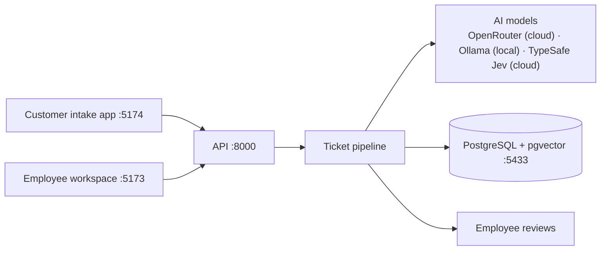

# ZainCash Support Pipeline

Back-office automation for Iraqi Arabic support tickets. Each ticket is classified, its details are extracted, the transaction is looked up, the ticket is routed to a team, and a reply is drafted from the knowledge base.

Built for the **Agentic AI Challenge Iraq, Topic 06: Support Pipeline Automation**.

> **A person approves every reply.** The system never sends messages, moves money, or changes accounts. Anything uncertain or unsafe is escalated with a reason.

## How it works



| Step | What happens | Default model |
|---|---|---|
| Intake | The customer describes the problem in a chat and can attach screenshots. | `anthropic/claude-sonnet-5.5` |
| Classify | Category, priority, flags, and the text spans for each field. | `jev-1.13.0` (TypeSafe) |
| Extract | Normalizes the fields. A model is asked only when a required field is missing. | `google/gemini-3.8-flash` |
| Lookup | Matches the transaction in the database. | none |
| Decide | Picks the team and priority from [`data/taxonomy.yaml`](data/taxonomy.yaml), or escalates. | none |
| Draft | Searches the knowledge base, writes a cited Arabic reply, and runs safety checks. | `anthropic/claude-sonnet-5.5` · embeddings `openai/text-embedding-3-small` |
| Review | An employee approves, edits, rejects, or reassigns. Nothing is sent automatically. | none |

An empty ticket skips straight to review as an escalation.

## Choosing models

The defaults above come from `.env`. An admin can change the model of any step while the system runs:

1. Set `ADMIN_TOKEN` in `.env` and restart the API.
2. In the employee workspace, open **Admin → AI models** and enter the token.
3. Click **Change model** on a step, pick a provider and a model, click **Test model**, then **Save**.

What to know:

- **Providers:** OpenRouter (cloud) and Ollama (local) for intake, extract, draft, and embeddings. Classification always uses Jev on TypeSafe.
- **Only suitable models are listed.** Drafting needs tool calling, intake needs vision, and embeddings must be 768 dimensions. You can also type any model ID.
- **A model is saved only after a live test passes.**
- **Changes apply to new batches and new customer chats.** Customers never see a change, and a chat keeps one model from start to finish.
- **No silent fallback.** If the chosen provider is down, the step fails and the ticket goes to a person with the reason. Nothing switches to another provider on its own.
- **Changing the embedding model re-indexes the knowledge base.** New batches wait until it finishes, and the switch cannot start while a batch is running.
- The top bar shows **AI: Local**, **AI: Cloud**, or **AI: Mixed**, so everyone can see where ticket data goes. Each run page lists the models it used.

## Quick start

You need WSL Ubuntu, Docker, `uv`, Node.js, a TypeSafe key, and an OpenRouter key.

1. **Configure.** Create a `.env` file in the repository root (it is gitignored):
   ```bash
   TYPESAFE_API_KEY=...
   OPENROUTER_API_KEY=...
   # Empty disables the admin page.
   ADMIN_TOKEN=...
   # Drafting and customer intake models; if empty, both use GEMINI_MODEL.
   ANTHROPIC_MODEL=anthropic/claude-sonnet-5.5
   INTAKE_MODEL=anthropic/claude-sonnet-5.5
   ```
   Every other setting has a default in [`backend/app/config.py`](backend/app/config.py); add a line to `.env` only to override one. Do not set `DATABASE_URL`: the API container builds it from `secrets/`. Copy each file in `secrets/` from its `.example` version, removing the `.example` suffix.
2. **Start the database and API:**
   ```bash
   docker compose up --build -d
   ```
3. **Start the employee workspace:**
   ```bash
   cd employee-frontend && npm ci && npm run dev
   ```
4. **Start the customer intake app** (optional):
   ```bash
   cd users-frontend && npm ci && npm --workspace web run dev
   ```

| App | Address |
|---|---|
| Employee workspace | http://localhost:5173 |
| Customer intake | http://localhost:5174 |
| API docs | http://localhost:8000/api/docs |
| PostgreSQL | `localhost:5433` |

After you change `.env`, restart the API (`docker compose up -d --build api`). Changes made on the admin page apply without a restart.

### Reset the demo database

Customers are identified by their phone number (`07XXXXXXXXX`), and every ticket and customer conversation belongs to one. A database created before this change cannot be upgraded in place: the API stops at startup and asks for a reset. To reset:

```bash
docker compose down -v
docker compose up --build -d
```

`docker compose down -v` also deletes uploaded knowledge-base documents, saved admin model choices and all tickets, runs and reviews.

Then load the demo data: in pgAdmin (database `support`, `localhost:5433`), run `docker/db/cleanup.sql` and then `docker/db/seed_demo.sql`.

## Local models with Ollama

1. Pull the models:
   ```bash
   ollama pull qwen3:4b          # extract and draft
   ollama pull nomic-embed-text  # embeddings (768 dimensions)
   ollama pull gemma3:4b         # intake (needs vision; qwen3:4b has none)
   ```
2. Make Ollama reachable from the API and set `OLLAMA_BASE_URL` in `.env`:
   - **Ollama on Windows, API in WSL or Docker inside WSL:** set the Windows user variable `OLLAMA_HOST=0.0.0.0:11434`, restart Ollama, and use `http://<windows-ip>:11434`. Run `ip route show default` in WSL to get the IP. Alternatively, enable WSL mirrored networking and use `http://localhost:11434`.
   - **Docker Desktop:** `http://host.docker.internal:11434`.
3. Choose the Ollama models on **Admin → AI models**.

Local models are slower. The settings `LOCAL_AGENT_TIMEOUT_S`, `LOCAL_INTAKE_TIMEOUT_S`, `LOCAL_NUM_CTX` (context window), and `LOCAL_PIPELINE_CONCURRENCY` (tickets processed at once) control them. Because Jev runs in the cloud, an all-Ollama setup shows **AI: Mixed**.

## Try the demo

1. Index the twelve policy PDFs in [`data/kb-pdf`](data/kb-pdf). That folder is the only policy reference:
   ```bash
   uv --directory backend run support ingest-kb ../data/kb-pdf
   ```
   Wait until each file is **Indexed**.
2. Open **New batch**, upload [`data/demo/rag_tickets.jsonl`](data/demo/rag_tickets.jsonl), and start processing. Every ticket in a batch file needs a `customer_phone`. The customer intake app asks for the phone number before the chat starts.
3. Open the results. Edit a reply and choose **Save & approve**.

The demo data and the files in `data/kb-pdf/` are fictional, not real ZainCash policies. See the [demo walkthrough](docs/demo-readiness.md).

## Committee test cases

Load the demo database first (`docker/db/cleanup.sql`, then `docker/db/seed_demo.sql`). Open the customer app at http://localhost:5174, enter the phone, and send the message. In the employee workspace, **دليل العملية** should show the seeded transaction.

1. **Pending transfer that left the wallet.** Phone `07809876543`. Matches pending `ZC2410000123`, 50,000 IQD to علي حسين on 2026-10-06.

   حولت 50,000 دينار يوم 2026-10-06 على رقم 07701234567 باسم علي حسين وانقطعت من رصيدي بس ما وصلتله. رقم العملية ZC2410000123 والتحويل للحين معلق.

2. **Receiver never got that transfer.** Phone `07701234567`. Same pending transfer, from the receiver's side.

   انا علي حسين. في تحويل 50,000 دينار يوم 2026-10-06 من رقم 07809876543 وما وصلني. رقم العملية ZC2410000123.

3. **Electricity bill marked paid but not posted.** Phone `07723334455`. Matches completed bill `ZC2410000456`, 35,000 IQD on 2026-10-01.

   دفعت فاتورة الكهرباء 35,000 دينار يوم 2026-10-01 وطلعت ناجحة بالتطبيق بس ما انحسبت عند الكهرباء. رقم العملية ZC2410000456.

4. **Completed transfer the sender did not make.** Phone `07501112233`. Fraud report that still matches completed `ZC2410000789`, 200,000 IQD on 2026-10-07.

   ما حولت اني. انسحب من حسابي 200,000 دينار يوم 2026-10-07 على رقم 07901234567 بعد ما اتصل بيه شخص وطلب رمز التحقق. رقم العملية ZC2410000789.

5. **Receiver got money from someone they do not know.** Phone `07901234567`. Same completed transfer, from the receiver's side.

   وصلني تحويل 200,000 دينار يوم 2026-10-07 من رقم 07501112233 وانا ما اعرف المرسل. رقم العملية ZC2410000789.

## Checks

```bash
cd backend && uv run pytest -q && uv run ruff check app tests
cd employee-frontend && npm test && npm run lint && npm run build
```

Backend integration tests use the separate `support_test` database. To process a file of tickets from the command line:

```bash
uv --directory backend run support run-batch ../data/demo/rag_tickets.jsonl --out ../out/run.json
```

## More documentation

- [Demo walkthrough and open work](docs/demo-readiness.md)
- [Pipeline design](docs/superpowers/specs/2026-10-07-support-pipeline-design.md)
- [Admin model configuration design](docs/superpowers/specs/2026-11-12-admin-model-config-design.md)
- Verification records: [RAG drafting](docs/verification/2026-10-17-rag-drafting.md), [customer intake](docs/verification/2026-10-18-customer-intake.md)

## License

This project is proprietary. The [license](LICENSE) lets a recipient read and study the source and ask the copyright holder questions. Publishing, selling, sharing it outside that recipient, or reusing it requires Saif Almaliki's prior written approval.
